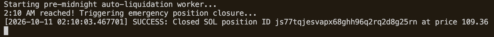
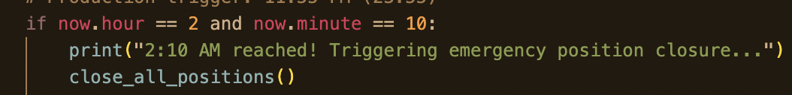
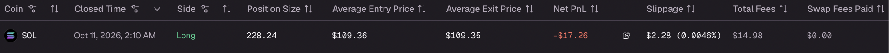

# Automated Risk Management & Pre-Midnight Position Closer

A production-ready Python utility built on top of the [MyFundedPerps Developer API](https://docs.myfundedperpetuals.com/api-reference/positions/close-part-or-all-of-a-position) to automate risk mitigation and position liquidation for perpetual futures traders.

## Overview

Managing overnight risk or avoiding platform-specific session penalties can be challenging with manual interventions. This script runs as a background worker, automatically scanning specified sandbox or live accounts, dynamically discovering internal account routing IDs, and flattening all active positions (supporting any asset class such as ETH, BTC, or SOL) safely right before a target cutoff time (e.g., 11:55 PM daily).

## Key Features

* **Multi-Account Dynamic Mapping:** Automatically queries the `/v1/accounts` endpoint to resolve the exact system-assigned identifier for specific target accounts (e.g., `FP-1234567`).
* **Universal Asset Support:** Dynamically fetches live market parameters (`mark_price` or `entry_price`) for any open position to seamlessly satisfy exchange-required slippage validation rules.
* **Idempotency & Execution Safety:** Employs UUID-based `Idempotency-Key` headers on close requests to prevent accidental duplicate order submissions during network anomalies.
* **Scheduled Automation:** Runs continuously in a background event loop, triggering precise pre-midnight liquidations with built-in duplicate window prevention.

## Requirements

* Python 3.8+
* `requests` library

```bash
pip install requests
```

## Visual Overview

<div align="center">
  <p><strong>Image 1: Terminal view showing the successful closing of a position.</strong></p>
  
</div>

<div align="center">
  <p><strong>Image 2: Manually changing the scheduled time for testing purposes.</strong></p>
  
</div>

<div align="center">
  <p><strong>Image 3: Log showing a successful position close.</strong></p>
  
</div>
